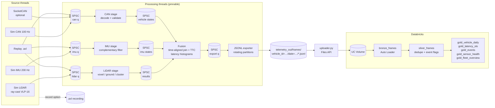

# AxleStream

Real-time vehicle telemetry on ARM. AxleStream is a multithreaded C++17 pipeline that
takes in LiDAR point clouds, IMU samples and CAN bus frames, processes each stream on its
own core, joins them by timestamp, and emits one fused record per LiDAR sweep. The target
is **under 10 ms per frame** from ingest to fused output. Fused records are exported as
partitioned JSON Lines batches, uploaded to a Databricks Unity Catalog volume, and turned
into fleet-level diagnostics tables by PySpark/Delta jobs.

You don't need any sensor hardware. Every input has a **simulated source** (a deterministic
drive scenario with a ray-cast 16-beam LiDAR, an IMU and a CAN bus), and any run can be
**recorded to and replayed from** a binary `.axl` file. Real CAN input over Linux
**SocketCAN** is optional.

## Features

- **Lock-free SPSC ring buffers** between all stages. Indices sit on separate cache lines,
  each side caches the other's index, and only acquire/release ordering is used, which is
  enough on ARMv8 and on x86. Each queue has exactly one producer and one consumer, and the
  pipeline enforces this.
- **LiDAR stage:** range crop → voxel-grid downsample → grid-based ground segmentation →
  8-connected occupancy clustering into obstacle boxes. Scratch buffers are reused, so
  steady-state processing barely allocates.
- **IMU stage:** complementary attitude filter. Its accelerometer gain adapts so that
  acceleration is not read as pitch, and it learns the gyro bias while the vehicle is still.
- **CAN stage:** decodes signals from a small DBC-equivalent signal table (wheel speed,
  steering, RPM/throttle, brake, gear) and checks DLC, checksum and rolling counter.
- **Fusion:** a time-aligned join of each sweep with the nearest IMU and vehicle state,
  plus time-to-collision for obstacles in the ego corridor.
- **Latency accounting:** log-bucketed histograms (about 3% resolution) per stage and end to
  end, with p50/p95/p99/max and a count of frames over budget.
- **Real-time options:** per-stage CPU pinning (`pthread_setaffinity_np`), optional
  `SCHED_FIFO` priority, and spin-then-sleep idle backoff.
- **Live vs lossless modes:** in live mode a full queue drops and counts the message, so a
  sensor thread never stalls. Offline replay and benchmarks use backpressure instead, so
  nothing is lost.
- **Databricks:** an idempotent uploader (Files API), an Auto Loader bronze job, a silver
  MERGE job, and gold tables for per-vehicle summaries, latency SLO, the event log, sensor
  health and a fleet risk ranking. A multi-task job definition is included.

## Architecture



## Repository layout

```
include/axle/        public headers (types, spsc_queue, latency, sources, processors, pipeline)
src/core/            latency histogram, thread affinity / RT helpers
src/sources/         vehicle scenario, simulated LiDAR/IMU/CAN, SocketCAN
src/io/              .axl codec, log writer/reader/replay, JSONL exporter
src/processing/      LiDAR processor, IMU filter, CAN decoder, fusion
src/pipeline/        threaded pipeline graph
src/app/             axlestream CLI, axle_bench
tests/               GoogleTest suites
cmake/               aarch64 cross toolchain
analytics/           Databricks package, jobs, job definition, pytest suite
scripts/             fleet simulation helper
```

## Building

Requirements: CMake 3.16 or newer, a C++17 compiler (GCC 9+ or Clang 10+), and pthreads.
GoogleTest is downloaded automatically when tests are enabled.

```bash
cmake -B build -DCMAKE_BUILD_TYPE=Release
cmake --build build -j
```

Useful options:

| Option | Default | Effect |
|---|---|---|
| `-DAXLE_WITH_SOCKETCAN=ON` | OFF | Build the SocketCAN source (Linux only) |
| `-DAXLE_NATIVE_ARCH=ON` | OFF | `-mcpu=native` on ARM, `-march=native` on x86 |
| `-DAXLE_BUILD_TESTS=OFF` | ON | Skip GoogleTest |

Cross-compiling for 64-bit ARM (Raspberry Pi 4/5, Jetson, Graviton):

```bash
sudo apt install g++-aarch64-linux-gnu
cmake -B build-arm -DCMAKE_TOOLCHAIN_FILE=cmake/aarch64-toolchain.cmake -DAXLE_BUILD_TESTS=OFF
cmake --build build-arm -j
# copy build-arm/axlestream to the target
```

## Running

### Simulated vehicle (no hardware)

```bash
# 60 s realtime drive; prints latency every second and writes telemetry_out/
./build/axlestream run --duration 60

# Pin LiDAR/IMU/CAN/fusion/export to cores 1-4 and 0, with SCHED_FIFO (needs root or CAP_SYS_NICE)
sudo ./build/axlestream run --duration 60 --pin 1,2,3,4,0 --rt-priority 50

# Inject CAN faults to exercise the validation path
./build/axlestream run --duration 30 --can-fault-rate 0.02
```

When a run ends it prints per-stage latency, for example
`end-to-end n=600 mean=… p50=… p99=… max=…`, and the number of frames over budget. It also
writes a JSON run summary to `telemetry_out/runs/vehicle_id=<id>/<run>.json`.

### Record and replay

```bash
./build/axlestream record --out drive.axl --duration 30       # capture simulated sensors
./build/axlestream inspect drive.axl                          # rates, span, CAN IDs
./build/axlestream run --source replay:drive.axl              # replay at recorded timing
./build/axlestream run --source replay:drive.axl --replay-speed 0 --no-export   # as fast as possible
./build/axlestream run --duration 30 --record live.axl        # record while processing
```

### Real CAN bus (optional)

To use real CAN, build with `-DAXLE_WITH_SOCKETCAN=ON` on Linux. The LiDAR and IMU stay
simulated:

```bash
# virtual bus for development
sudo modprobe vcan && sudo ip link add dev vcan0 type vcan && sudo ip link set up vcan0
./build/axlestream run --can-iface vcan0
# then, in another shell: cangen vcan0   (or canplayer with a candump log)
```

The decoder understands the IDs in `include/axle/can_db.hpp`. Frames with other IDs are
counted as `unknown_id`. To decode a real vehicle's bus, edit that table to match its DBC.

### Fleet simulation

```bash
scripts/simulate_fleet.sh 4 120 telemetry_out     # 4 vehicles x 120 s in parallel
FAST=1 scripts/simulate_fleet.sh 8 600            # faster than realtime (lossless)
```

### Benchmark

```bash
./build/axle_bench --frames 300 --pin-a 2 --pin-b 3
```

This reports LiDAR processing time per sweep against the 10 ms budget, the one-way
SPSC hand-off latency between two pinned threads, and pipeline throughput in lossless mode.

## Databricks analytics

```bash
cd analytics
python -m venv .venv && source .venv/bin/activate
pip install -r requirements.txt
cp ../.env.example ../.env       # fill in DATABRICKS_HOST / DATABRICKS_TOKEN
```

1. **Local analysis, no workspace needed.** This runs the same bronze → silver → gold
   transformations on local Spark (Java 8/11/17 required):
   ```bash
   python jobs/local_run.py --src ../telemetry_out --out ../analytics_out
   ```
2. **Upload to a Unity Catalog volume.** The uploader is idempotent and skips files that
   are still being written:
   ```bash
   python -m axle_analytics.uploader --src ../telemetry_out --dry-run
   python -m axle_analytics.uploader --src ../telemetry_out            # or --watch 60
   ```
   First create the catalog objects:
   `CREATE SCHEMA IF NOT EXISTS main.axlestream; CREATE VOLUME IF NOT EXISTS main.axlestream.raw_telemetry;`
3. **Schedule the jobs.** Create the job from `analytics/databricks_job.json` (Jobs API 2.1
   or `databricks jobs create --json @analytics/databricks_job.json`). It runs
   `bronze_ingest` → `silver_frames` → `gold_fleet_diagnostics`. Adjust `node_type_id` for
   your cloud.

Gold tables:

| Table | Grain | Contents |
|---|---|---|
| `gold_vehicle_daily` | vehicle × day | distance, speed, latency p50/p99, SLO compliance, event counts |
| `gold_latency_slo` | vehicle × hour | e2e and LiDAR latency percentiles vs budget |
| `gold_events` | event | harsh brake/accel/lateral, FCW, IMU anomaly, roll, latency breach, LiDAR degraded, CAN errors |
| `gold_sensor_health` | vehicle × day | LiDAR point density, IMU/CAN match rates, triage flag |
| `gold_fleet_overview` | vehicle × day | risk events per 100 km with rank |

Credentials come only from environment variables or `.env`, which is git-ignored.
Nothing secret is committed.

## Testing

C++ (GoogleTest, through CTest):

```bash
cmake -B build -DCMAKE_BUILD_TYPE=RelWithDebInfo
cmake --build build -j
ctest --test-dir build --output-on-failure
# or run the binary directly: ./build/tests/axle_tests --gtest_filter='Pipeline.*'
```

The C++ suites cover:
- SPSC ordering under concurrency
- histogram accuracy
- `.axl` round-trips and truncation handling
- simulator rates
- LiDAR segmentation and clustering
- IMU filter convergence, bias learning and acceleration gating
- CAN checksum and counter validation
- fusion time alignment and TTC
- lossless end-to-end runs, replay equivalence, fault counting and shutdown
- exporter partitioning and rotation

To check for data races, build with `-DCMAKE_CXX_FLAGS=-fsanitize=thread` and run `ctest`.

Python (pytest):

```bash
cd analytics && pytest -q
```

The rule and uploader tests are pure Python. The Spark transformation tests skip
automatically when PySpark or a JVM is not available.

## Design notes

- **Measuring latency.** Each message gets a monotonic `ingest_ns` stamp when it enters the
  pipeline. The end-to-end figure runs from the LiDAR sweep's ingest to the fused record,
  which is the per-frame latency the 10 ms budget applies to. Export latency is reported
  separately because file I/O is off the critical path.
- **Time alignment.** The fusion stage only takes IMU and CAN states up to the sweep
  timestamp + 5 ms, so the join stays correct when the light stages run ahead (fast
  replay). In lossless mode it also waits, for at most 200 ms, for lagging state streams to
  catch up, which makes offline runs deterministic.
- **Simulation fidelity.** The scenario is a repeating accelerate / cruise / brake / stop
  cycle on a gentle S-curve, with parked cars, poles and trucks along the route. The LiDAR
  rays are cast against the ground plane and against the obstacle boxes, with range noise
  and dropouts. The IMU sees the true kinematics plus noise and a constant gyro bias.
